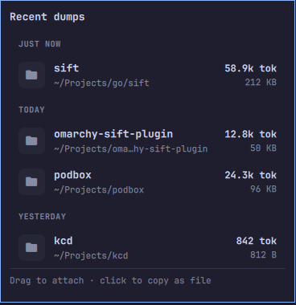

# Omarchy sift dumps

[](LICENSE)
[](https://omarchy.org)
[](https://github.com/tcballard/omarchy-badges)

An Omarchy Quattro `bar-widget` for [sift](https://github.com/bethropolis/sift), the codebase-to-context tool. Keep your recent dumps in the bar and hand them to another app as a file: drag one into a browser upload or a file manager, or click it to copy the archive as a `file://` URI.



## What it does

- Shows only the two-bar sift mark in the bar — no labels, counts or badges.
- Opens a grouped **Recent dumps** panel: just now, today, yesterday and earlier.
- Shows the project name, home-shortened path, token estimate and archive size.
- Drags a row as `text/uri-list` so browsers, file managers and chat apps receive the archive as a file.
- Clicks a row to copy its `file://` URI as a file, ready to paste.
- Watches sift history while the panel is open, so a new dump appears without reopening it.
- Shows a clear card when sift is missing, outdated, or has no dumps yet. The install command is copyable, never executed.

## Requires

- Omarchy Quattro with `omarchy-shell`
- sift **1.9.0+**, built with `sift history` support
- `wl-clipboard` for click-to-copy and the notice-card Copy button

The drag-out path is native Wayland `text/uri-list`. It has been tested from Omarchy's layer-shell panel into a Firefox HTML5 drop zone.

## Install

### sift

Install the current package from the AUR:

```sh
yay -S sift-context-bin
```

History is opt-in. Enable it globally in `~/.config/sift/config.toml`, or per project in `.sift.toml`:

```toml
[history]
enabled = true
keep = 20
```

`sift history --json` is empty until this is enabled and a dump succeeds.

### Plugin

```sh
omarchy plugin add https://github.com/bethropolis/omarchy-sift-plugin.git --enable
```

If the bar does not pick it up, place it explicitly:

```sh
omarchy bar move io.github.bethropolis.sift-dumps --section right
```

## Usage

- Click the sift mark to open the recent-dumps panel. Click it again, or press `Escape`, to close.
- Hover a row, or use `Tab` / arrow keys to focus one.
- Drag a row into a target that accepts files; the row uses only `text/uri-list`.
- Click a row to copy its file URI. Paste it into your app as a file.
- `Enter` / `Space` on a focused row does the same copy action.
- The footer is intentional: **Drag to attach · click to copy as file**.

The panel reads the public `sift history` contract, not `history.jsonl`. It refreshes when opened and watches the history file only while open.

### Notice cards

| State | What you see |
|---|---|
| sift missing | `sift isn't installed`, with a copyable `yay -S sift-context-bin` command |
| sift too old | `sift needs updating`, with the same command |
| no dumps | `No dumps yet` |
| loading | `Loading dumps…` |

The plugin only copies the install command. It never runs a package manager.

## Where state lives

The plugin owns no state of its own. It uses sift's files:

| Data | Path |
|---|---|
| History log | `${XDG_DATA_HOME:-~/.local/share}/sift/history.jsonl` |
| Archived dumps | `${XDG_CACHE_HOME:-~/.cache}/sift/dumps/` |

Clear both with sift:

```sh
sift history clear -y
```

## How it works

`HistoryStore.qml` locates sift with `command -v` and the fixed candidates
`~/.local/bin/sift`, `~/go/bin/sift`, `/usr/bin/sift`, then runs:

```sh
sift history --json --limit 20
sift history --path
```

The history file is watched in watch-only mode (`preload: false`, no read of
its contents) and changes are debounced by 150 ms. Entries are placed with
`HistoryStore`, formatted by the pure helpers in `Model.js`, and rendered by
`DumpRow.qml`. The panel uses a card-sized input region so an external drag can
reach the application underneath it.

## Files

| File | Purpose |
|---|---|
| `manifest.json` | Plugin contract (`bar-widget` → `BarWidget.qml`) |
| `BarWidget.qml` | Logo-only bar item and panel lifecycle |
| `Panel.qml` | Recent-dumps panel, grouping, keyboard navigation |
| `HistoryStore.qml` | Locator, CLI calls, state machine and history watcher |
| `DumpRow.qml` | Row layout, focus/hover, drag-out and click-copy |
| `NoticeCard.qml` | Missing, outdated and empty states |
| `Model.js` | Pure formatting, grouping, path and URI helpers |
| `preview.png` | Panel preview used by the README and marketplace |
| `test/` | Node tests, fixtures and `run.sh` |

## Development

Run the repository checks:

```sh
./test/run.sh
```

This runs the Node model tests, `omarchy plugin validate`, and `qmllint` over
every QML component. To check the installed copy instead:

```sh
PLUGIN_DIR="$HOME/.config/omarchy/plugins/io.github.bethropolis.sift-dumps" ./test/run.sh
```

The Go history implementation lives in the separate
[`bethropolis/sift`](https://github.com/bethropolis/sift) repository, not here.
The plugin itself is intentionally small: `Panel.qml` owns the lifecycle and
layout, `HistoryStore.qml` owns sift IO, and `Model.js` stays pure and testable.

## Remove

```sh
omarchy plugin remove io.github.bethropolis.sift-dumps
```

Optionally remove sift's history separately:

```sh
sift history clear -y
```

## Safety

Omarchy plugins run unsandboxed inside the desktop shell. This plugin is
local-only: no network access, telemetry, install hooks, privilege escalation,
dump-content preview or file deletion. It is a read-only history viewer apart
from asking `wl-copy` to place a file URI on the clipboard.

## Status

v1.0.0. The panel, live history, notice states, click-copy and browser drag
target are live-tested. Native drag is offered as `text/uri-list`; applications
that do not accept file URIs can use click-copy instead.

## License

MIT. See [LICENSE](LICENSE).
